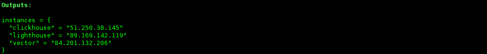
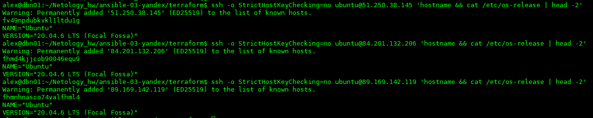
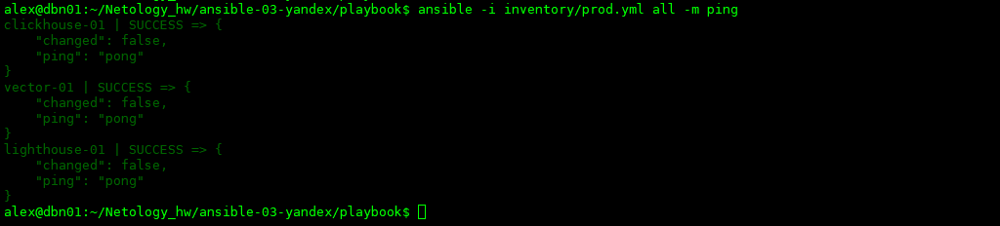
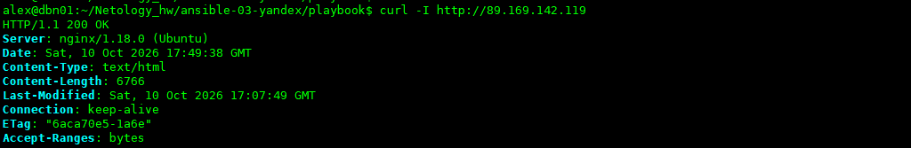
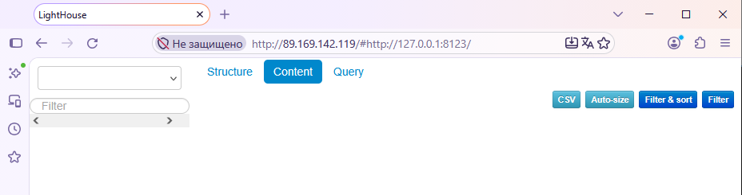
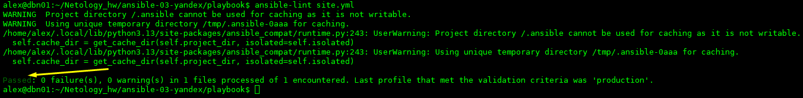
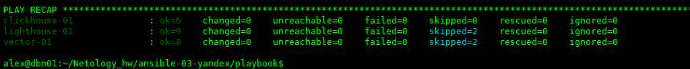

# Домашнее задание к занятию 3 «Использование Ansible» - Некрасов Александр

## Подготовка к выполнению

1. Подготовьте в Yandex Cloud три хоста: для `clickhouse`, для `vector` и для `lighthouse`.
2. Репозиторий LightHouse находится [по ссылке](https://github.com/VKCOM/lighthouse).

## Основная часть

1. Допишите playbook: нужно сделать ещё один play, который устанавливает и настраивает LightHouse.
2. При создании tasks рекомендую использовать модули: `get_url`, `template`, `yum`, `apt`.
3. Tasks должны: скачать статику LightHouse, установить Nginx или любой другой веб-сервер, настроить его конфиг для открытия LightHouse, запустить веб-сервер.
4. Подготовьте свой inventory-файл `prod.yml`.
5. Запустите `ansible-lint site.yml` и исправьте ошибки, если они есть.
6. Попробуйте запустить playbook на этом окружении с флагом `--check`.
7. Запустите playbook на `prod.yml` окружении с флагом `--diff`. Убедитесь, что изменения на системе произведены.
8. Повторно запустите playbook с флагом `--diff` и убедитесь, что playbook идемпотентен.
9. Подготовьте README.md-файл по своему playbook. В нём должно быть описано: что делает playbook, какие у него есть параметры и теги.
10. Готовый playbook выложите в свой репозиторий, поставьте тег `08-ansible-03-yandex` на фиксирующий коммит, в ответ предоставьте ссылку на него.

---

### Решение


Playbook `site.yml` устанавливает и настраивает три сервиса на трёх хостах в Yandex Cloud:
### Подготовка инфраструктуры:

Вывод terraform:


Проверка доступности ВМ через SSH.




### 1. ClickHouse (clickhouse-01)

- Устанавливает зависимости (`tzdata`)
- Скачивает `.deb` пакеты напрямую с `packages.clickhouse.com`:
  - `clickhouse-common-static_22.3.3.44_amd64.deb`
  - `clickhouse-client_22.3.3.44_all.deb`
  - `clickhouse-server_22.3.3.44_all.deb`
- Устанавливает через `apt`
- Запускает сервис через systemd (handler)
- Создаёт базу данных `logs`

_Репозиторий ClickHouse на момент выполнения задания был недоступен (HTTP 404), поэтому используется прямое скачивание `.deb` файлов через `get_url`._


### 2. Vector (vector-01)

- Устанавливает `ca-certificates`, `tar`, `gzip`
- Скачивает дистрибутив с `packages.timber.io`
- Распаковывает в `/opt/vector`
- Создаёт `/var/lib/vector` (data dir)
- Деплоит конфиг `/etc/vector/vector.toml` через Jinja2-шаблон
- Запускает Vector
- Перезапускает при изменении конфига (handler)

### 3. Lighthouse (lighthouse-01)

- Устанавливает Nginx и unzip
- Скачивает статику Lighthouse с GitHub
- Распаковывает в `/var/www/`
- Переименовывает `lighthouse-master` → `lighthouse`
- Настраивает Nginx через Jinja2-шаблон
- Запускает Nginx




**Доступность через браузер по адресу:** http://89.169.142.119



### Параметры (переменные)

### `group_vars/clickhouse/vars.yml`

| Переменная | Описание | Значение |
|-----------|----------|----------|
| `clickhouse_version` | Версия ClickHouse | `22.3.3.44` |
| `clickhouse_debs` | Список пакетов с архитектурами | 3 пакета |

### `group_vars/vector/vars.yml`

| Переменная | Описание | Значение |
|-----------|----------|----------|
| `vector_version` | Версия Vector | `0.21.1` |
| `vector_install_dir` | Директория установки | `/opt/vector` |

### `group_vars/lighthouse/vars.yml`

| Переменная | Описание | Значение |
|-----------|----------|----------|
| `lighthouse_version` | Версия | `master` |
| `lighthouse_archive_url` | URL архива | GitHub |
| `lighthouse_dir` | Директория | `/var/www/lighthouse` |

### Теги

Playbook состоит из **трёх play** (без явных тегов):

| Play | Группа хостов |
|------|--------------|
| `Install ClickHouse (download .deb packages)` | `clickhouse` |
| `Install and configure Vector` | `vector` |
| `Install and configure Lighthouse` | `lighthouse` |

### Inventory

### `inventory/prod.yml`

```yaml
---
clickhouse:
  hosts:
    clickhouse-01:
      ansible_host: 51.250.38.145
      ansible_user: ubuntu
      ansible_ssh_private_key_file: ~/.ssh/id_ed25519

vector:
  hosts:
    vector-01:
      ansible_host: 84.201.132.206
      ansible_user: ubuntu
      ansible_ssh_private_key_file: ~/.ssh/id_ed25519

lighthouse:
  hosts:
    lighthouse-01:
      ansible_host: 89.169.142.119
      ansible_user: ubuntu
      ansible_ssh_private_key_file: ~/.ssh/id_ed25519
```

### Инфраструктура:

ВМ созданы в Yandex Cloud через Terraform:

| ВМ             |	Зона |	Назначение |
|----------------|-----------------|------------|
| clickhouse-01  |	ru-central1-d |	ClickHouse |
| vector-01	| ru-central1-a	| Vector |
| lighthouse-01	| ru-central1-a	| Lighthouse + Nginx |

Проверка синтаксиса

`ansible-playbook -i inventory/prod.yml site.yml --syntax-check`

Линтинг

`ansible-lint site.yml`


Dry-run

`ansible-playbook -i inventory/prod.yml site.yml --check`

Реальный запуск с diff

`ansible-playbook -i inventory/prod.yml site.yml --diff`

Повторный запуск (проверка идемпотентности)

`ansible-playbook -i inventory/prod.yml site.yml --diff`




